# Laporan Tree-sitter Part 1

## Tugas 1 — Membaca pohon

Saya mem-parse empat potongan kode Python dengan `t1.py` dan mencetak `tree.root_node`: fungsi, if/else, kelas, dan kode rusak.

**Fungsi** (`def sapa(nama): return nama`)


**if/else**


**Kelas**

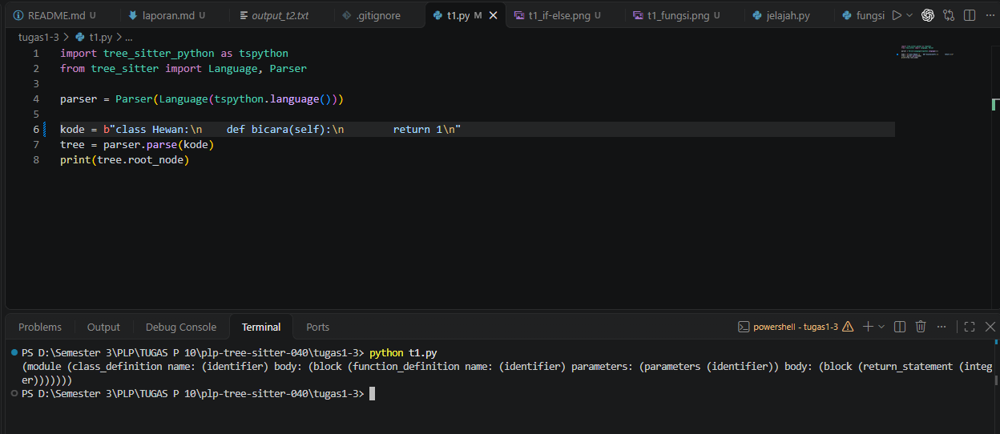

**Kode rusak** (tanda `:` setelah `def sapa(nama)` dihapus)

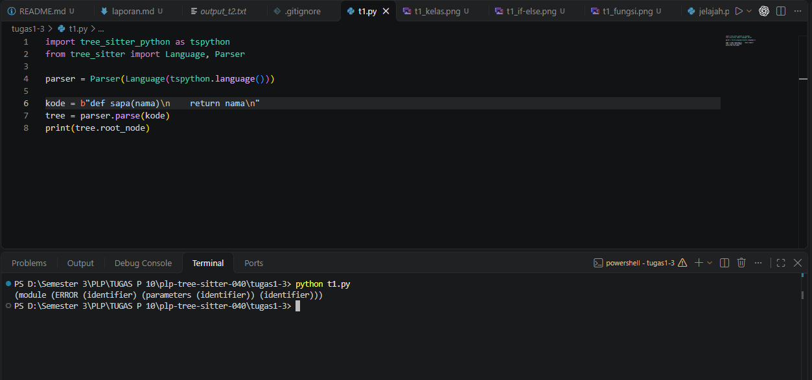

**Pohon perkiraan tulisan tangan**

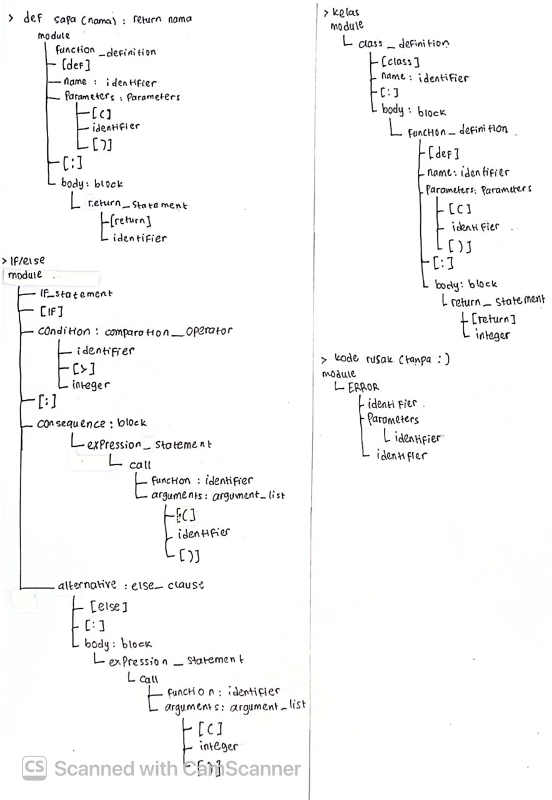

**Penjelasan**

- Node bernama muncul di output `tree.root_node`, misalnya `function_definition`, `identifier`, `parameters`, dan `block`.
- Node anonim tidak tampil di output, tetapi tetap ada di pohon. Contoh dari kode fungsi: `def`, `:`, dan `(` `)` di dalam `parameters`.
- Pada kode rusak, parser tidak lagi mengenali `function_definition`, sehingga semua bagiannya dibungkus node `ERROR`.
- Perbedaan `children` dan `named_children`: pada node `function_definition` dari `def sapa(nama): return nama`, `children` berisi 5 node (`def`, `identifier`, `parameters`, `:`, `block`), sedangkan `named_children` hanya 3 (`identifier`, `parameters`, `block`) karena `def` dan `:` anonim.

**Kendala:** saya belum terbiasa membaca output satu baris panjang. Saya mengatasinya dengan menulis ulang pohon dengan indentasi per tingkat dan membandingkannya dengan output program.

## Tugas 2 — Penjelajah node

`jelajah.py` menelusuri pohon secara rekursif (DFS). Setiap node bernama dicetak dengan indentasi sesuai kedalaman, posisi `baris:kolom`, dan nama field-nya lewat `field_name_for_child(i)`. Node anonim dilewati dengan filter `is_named`.

Pengujian bertahap: `kecil.py` (`x = 1`), `fungsi.py`, lalu file nyata `colorsys.py` (166 baris) dari pustaka standar Python.


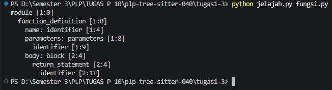

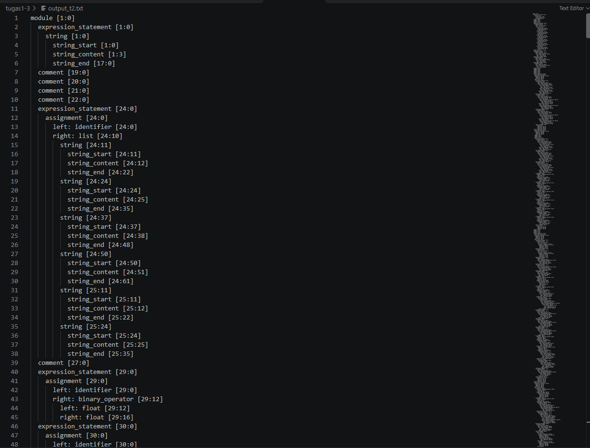

**Kendala:**
- Indeks `i` untuk `field_name_for_child(i)` harus berasal dari `node.children` (semua child), bukan `named_children`. Kalau tidak, nama field bergeser atau tidak muncul.
- Output yang dialihkan dengan `>` di PowerShell tersimpan sebagai UTF-16. Saya mengatasinya dengan `| Out-File -Encoding utf8 output_t2.txt`.

## Tugas 3 — Query pertama

Saya menulis query `.scm` dan menjalankannya dengan `QueryCursor` lewat `query.py` (untuk `captures`) dan `query_params.py` (untuk `matches`) pada file uji `contoh.py`.

**Query 1: nama fungsi dan jumlah parameternya** (`params.scm`)

```scheme
(function_definition
  name: (identifier) @nama
  parameters: (parameters) @params)
```


**Query 2: pemanggilan `print(...)`** (`print.scm`)

```scheme
(call
  function: (identifier) @fn
  arguments: (argument_list) @args
  (#eq? @fn "print"))
```


**Query 3: import dan from-import, dicetak nama modulnya** (`import.scm`)

```scheme
(import_statement name: (dotted_name) @modul)
(import_from_statement module_name: (dotted_name) @modul)
```


**Pencocokan dengan hitungan manual pada `contoh.py`**

| Query | Hitungan manual | Hasil program |
| --- | --- | --- |
| Fungsi dan jumlah parameter | `tambah` 2, `kali` 2, `halo` 0 | Sama |
| `print(...)` | 2 (baris 8 dan 13) | Sama |
| Import | `os` (baris 1), `pathlib` (baris 2) | Sama |

**Penjelasan**

- `captures` mengembalikan semua node per nama capture, cocok untuk daftar sederhana. Untuk pasangan nama fungsi dan parameternya saya memakai `matches`, karena dua capture dalam satu pola harus tetap berpasangan.
- Nama node untuk import tidak ditebak: saya menjalankan `jelajah.py` pada `contoh.py` lebih dulu. Hasilnya `import_statement` (field `name:`) dan `import_from_statement` (field `module_name:`), keduanya berisi `dotted_name`.
- `import_from_statement` punya dua `dotted_name`: `module_name:` (modul, misalnya `pathlib`) dan `name:` (yang diimpor, misalnya `Path`). Memakai field `module_name:` memastikan hanya modulnya yang tertangkap.

**Kendala:** untuk jumlah parameter, `captures` tidak bisa memasangkan nama fungsi dengan parameternya, jadi saya beralih ke `matches` dan membaca `cap["params"][0].named_child_count`.

**Pengujian batas query import** (`uji_import.py`)


Query import belum menangkap `import numpy as np` karena bentuk node-nya `aliased_import`. Ini keterbatasan yang saya temukan, tidak diperbaiki karena di luar yang diminta soal.

## Tugas 4 — Grammar DSL filter

Saya membangun grammar `filter` bertahap di `tree-sitter-filter/` (langkah 4a–4f), lalu menambah `in` dan `contains`. Setiap langkah dicek dengan `tree-sitter generate` dan `tree-sitter parse`, lalu disimpan sebagai kasus uji di `test/corpus/dasar.txt`. Hasil akhir: 8 tes lulus.

**Fitur yang ditambahkan**

| Langkah | Fitur |
| --- | --- |
| 4a | Operator `!=`, `>`, `<`, `>=`, `<=` dan `number` |
| 4b | `_expr`, `and_expression`, dan `word` |
| 4c | `or_expression` dengan `prec.left` |
| 4d | `parenthesized` |
| 4e | `not_expression` dan `boolean` |
| 4f | `field(...)` pada `comparison`, `and`/`or`, dan `not` |
| Akhir | `in_expression` (daftar nilai) dan `contains_expression` |

**Prioritas `and` dan `or`.** `a = 1 or b = 2 and c = 3` terbaca sebagai `a = 1 or (b = 2 and c = 3)`, karena `and` diberi prioritas 2 dan `or` prioritas 1. Kurung mengubahnya: `(a = 1 or b = 2) and c = 3` mengelompokkan `or` lebih dulu.

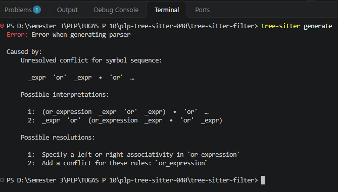

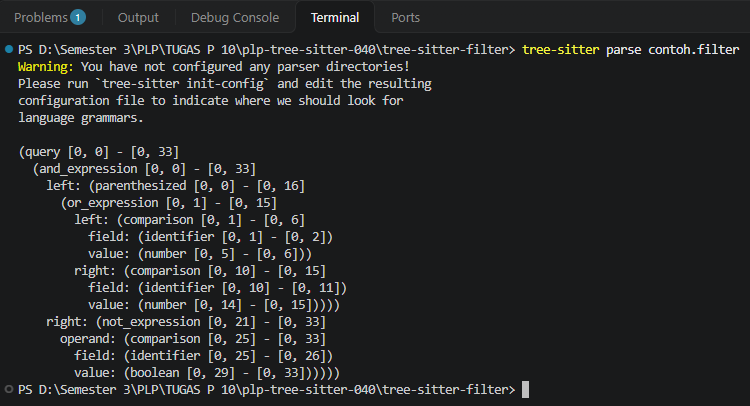

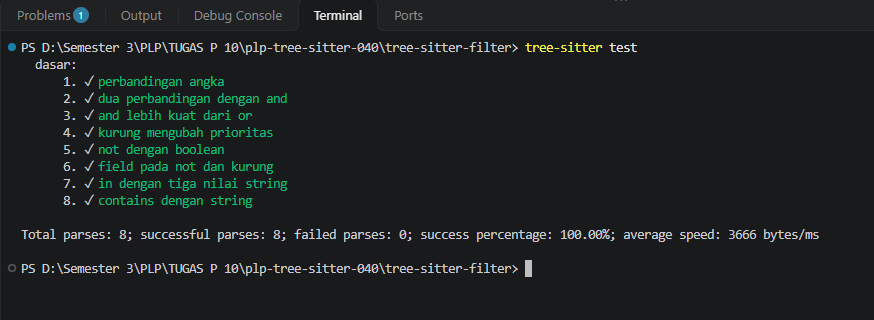

**Kendala dan cara mengatasinya**

- `tree-sitter generate` gagal dengan `module is not defined in ES module scope`. Soal memakai `module.exports = grammar(...)`, tetapi CLI 0.27.2 dan `package.json` hasil `init` memakai `"type": "module"`. Saya mengganti menjadi `export default grammar(...)`.
- `and_expression` di langkah 4b juga menimbulkan `Unresolved conflict` (`a and b and c` bisa dibaca dua cara). Saya menambah `prec.left(2, ...)`. Di langkah 4c konflik yang sama muncul untuk `or`, yang sengaja dialami, dan diselesaikan dengan `prec.left(1, ...)`.
- Peringatan `You have not configured any parser directories` muncul saat `parse`, tetapi tidak menghalangi hasilnya.

## Tugas 5 — Highlight untuk DSL filter

Saya membuat `queries/highlights.scm` untuk grammar `filter`, lalu memeriksanya dengan `tree-sitter highlight contoh.filter`. Konfigurasi yang dibutuhkan: `tree-sitter init-config` dengan `parser-directories` berisi folder induk `tree-sitter-filter/`, dan `"highlights": "queries/highlights.scm"` di `tree-sitter.json` (`file-types` sudah berisi `"filter"`).

**Captures yang dipakai**

| Token | Capture |
| --- | --- |
| `and`, `or`, `not`, `in`, `contains` | `@keyword` |
| `=`, `!=`, `>`, `<`, `>=`, `<=` | `@operator` |
| string | `@string` |
| angka | `@number` |
| boolean | `@type.builtin` |
| nama field (di `comparison`, `in_expression`, `contains_expression`) | `@property` |
| `(` `)` dan `,` | `@punctuation.bracket`, `@punctuation.delimiter` |

Hasil `tree-sitter highlight contoh.filter` pada `title contains "invoice" and not archived = true or priority >= 2 and status in ("open", "pending")`. Setiap jenis token punya warna berbeda:

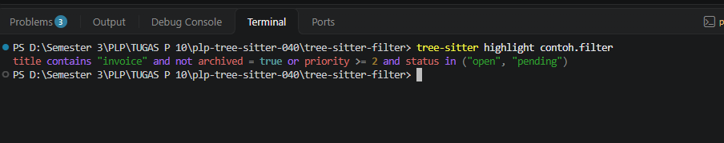

**Kendala dan cara mengatasinya**

- `tree-sitter highlight` gagal dengan `The system cannot find the path specified`, karena `highlights.scm` tersimpan di `bindings/python/tree_sitter_filter/queries/`. CLI mencari di `tree-sitter-filter/queries/`, jadi file saya pindahkan ke sana.
- Entri terakhir `parser-directories` di `config.json` tanpa koma membuat JSON tidak valid. Saya merapikannya menjadi satu entri berisi folder induk.
- Contoh di soal memakai `@constant.builtin` untuk boolean, tetapi di tema bawaan CLI warnanya sama dengan `@number`. Saya menggantinya dengan `@type.builtin` supaya tiap jenis token punya warna berbeda.

Bukti warna yang sama dengan capture dari contoh (`true` dan `2` sama-sama cokelat tebal):

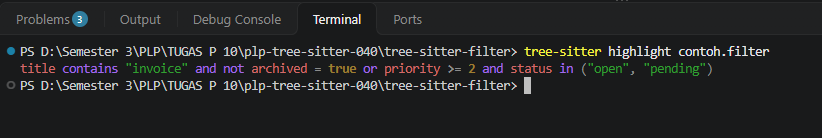

## Tugas 6 — Mini proyek: pendeteksi TODO dan fungsi panjang

`cek/cek.py <folder>` memeriksa semua file `.py` di sebuah folder dengan tree-sitter dan melaporkan tiga hal: (1) komentar `TODO`/`FIXME` lewat query `#match?`, (2) fungsi yang lebih dari 30 baris lewat `matches` dan `end_point[0] - start_point[0] + 1`, serta (3) file yang pohonnya error lewat `root_node.has_error`, lengkap dengan baris pertama yang bermasalah (fungsi rekursif mencari node `is_error` atau `is_missing`). Folder `venv`, `.git`, `node_modules`, dan sejenisnya dilewati. Cara pakai ada di `cek/README.md`.

**Uji kecil** (`cek/uji/`): `todo.py`, `panjang.py` (37 baris), dan `rusak.py` (tanpa `:`) menghasilkan satu temuan sesuai tiap file.

**Uji pada repo nyata** (`psf/requests`, 37 file `.py`): hasil lengkap di `cek/output_requests.txt`.

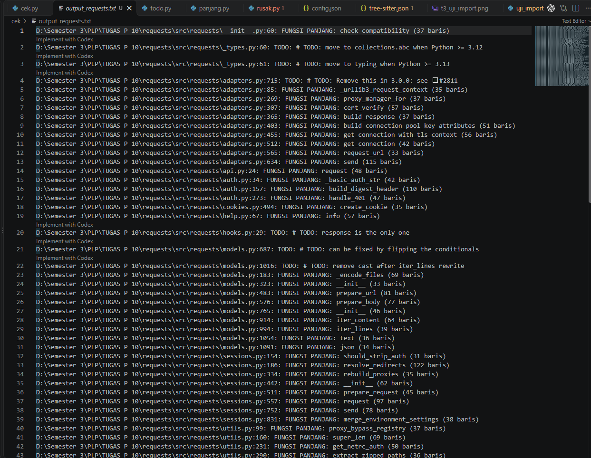

**Pencocokan manual pada 2 file**

| File | Hasil `cek.py` | Pengecekan manual |
| --- | --- | --- |
| `src/requests/hooks.py` | satu TODO di baris 29 | satu TODO di baris 29 |
| `src/requests/api.py` | `request` (48 baris) di baris 24 | fungsi mulai baris 24, berakhir baris 71: 71 - 24 + 1 = 48 |

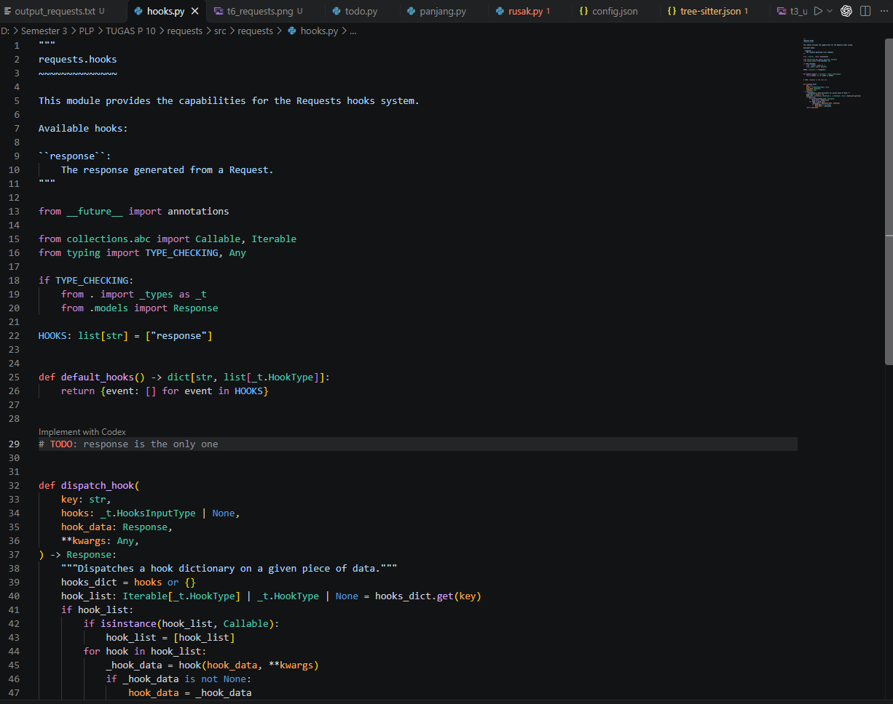

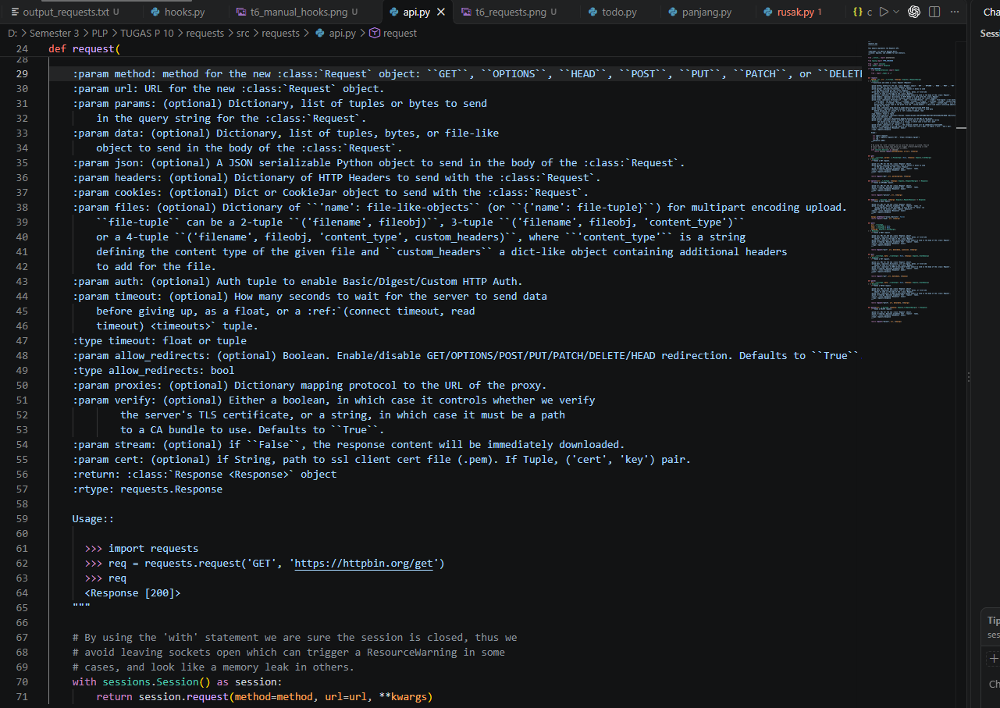

**Keterbatasan query TODO** (`uji/palsu.py`)

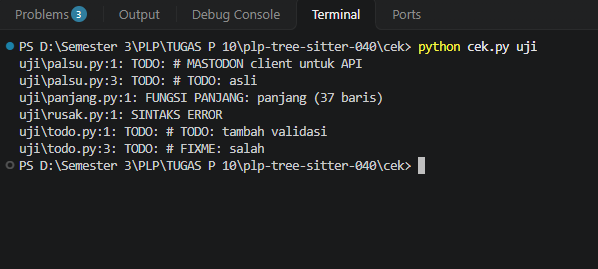

**Kendala dan cara mengatasinya**

- Fungsi bersarang dan metode kelas ikut terhitung dalam laporan fungsi panjang, sesuai petunjuk soal. Hal ini dicatat di README.
- Karakter non-UTF-8 bisa membuat `UnicodeDecodeError`. Saya memakai `decode(errors="replace")`.
- Pada repo besar, folder seperti `venv/` dan `.git/` dilewati dengan memeriksa `path.parts` sebelum memanggil `cek_file`.
- Output PowerShell dengan `>` tersimpan sebagai UTF-16, jadi hasilnya disimpan lewat `Out-File -Encoding utf8`.

## Catatan penggunaan AI

| Tugas | Yang diminta | Kesalahan AI | Bukti verifikasi |
| --- | --- | --- | --- |
| 1 | Pohon perkiraan untuk fungsi, if/else, kelas, dan kode rusak | (a) Operator `>` pada `comparison_operator` ditulis tanpa label field. Yang benar `operators: [>]`. (b) Pohon `ERROR` pada kode rusak ditulis tanpa node anonim `def`, `(`, `)`, `return`. | Mencetak pohon lengkap dengan program yang menelusuri `node.children` beserta `field_name_for_child`, lalu membandingkannya dengan tulisan AI. Hasilnya berbeda pada dua bagian itu. |
| 2 | Isi bagian `TODO` pada `jelajah.py` dan menyimpan outputnya | Perintah `python jelajah.py ... > output_t2.txt` yang disarankan menyimpan file dalam UTF-16 LE di PowerShell, sehingga teksnya rusak di editor lain. | VS Code menampilkan encoding UTF-16 LE pada `output_t2.txt`; setelah diganti `\| Out-File -Encoding utf8` menjadi UTF-8. Isi output `kecil.py` dan `fungsi.py` sendiri sama dengan output di soal. |
| 3 | Query fungsi + parameter, `print`, dan import | Query import tidak menangkap `import numpy as np`, karena node-nya `aliased_import`, bukan `dotted_name` langsung. | Menjalankan `query.py` pada `uji_import.py`: 5 modul diimpor, program hanya menampilkan 4 (`numpy` hilang). |
| 4 | Langkah 4a–4f, `in_expression`, dan `contains_expression` pada grammar `filter` | Grammar tidak menerima angka negatif, karena `number` hanya `/\d+(\.\d+)?/` tanpa tanda minus. | `tree-sitter parse` pada `priority > -1` menghasilkan node `ERROR` di posisi `-` (`ss/t4_negatif.png`). |
| 5 | Isi `highlights.scm` dan konfigurasi highlight | Contoh capture boolean `@constant.builtin` membuat `true` dan angka `2` berwarna sama di tema bawaan CLI, sehingga token tidak bisa dibedakan. | `tree-sitter highlight contoh.filter` dengan capture itu: `true` dan `2` sama-sama cokelat tebal (`ss/t5_boolean_sama.png`). Diganti `@type.builtin`. |
| 6 | Kerangka `cek.py` dan tiga fitur | Query TODO `#match? @c "TODO|FIXME"` tidak memakai batas kata: komentar `# MASTODON ...` salah dilaporkan sebagai TODO, sedangkan `# todo` huruf kecil tidak terdeteksi. | Menjalankan `cek.py` pada `uji/palsu.py`: baris 1 salah dilaporkan, baris 2 terlewat (`ss/t6_palsu.png`). |

Catatan: pohon perkiraan tulisan tangan di Tugas 1 dibuat berdasarkan jawaban AI, lalu saya verifikasi dengan menjalankan `t1.py` sendiri.