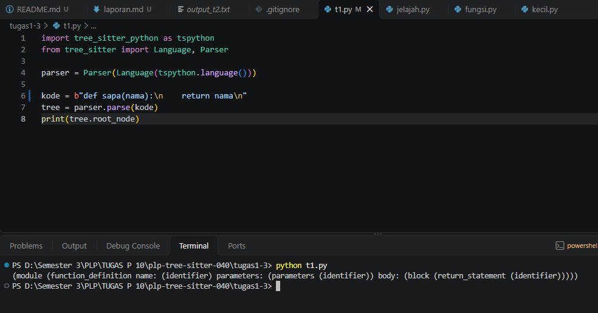
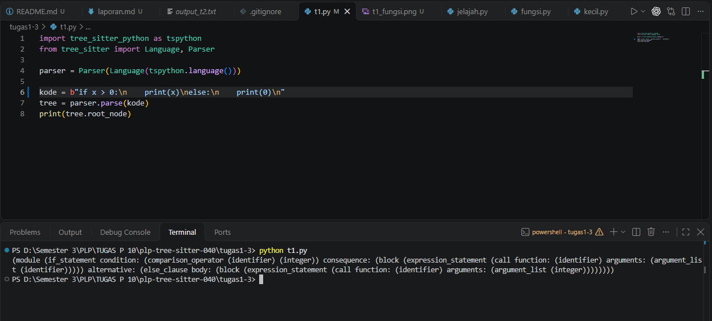

# Laporan Tree-sitter Part 1

## Tugas 1 — Membaca pohon

Saya mem-parse empat potongan kode Python dengan `t1.py` dan mencetak `tree.root_node`: fungsi, if/else, kelas, dan kode rusak.

**Fungsi** (`def sapa(nama): return nama`)

**if/else**

**Kelas**

**Kode rusak** (tanda `:` setelah `def sapa(nama)` dihapus)

**Pohon perkiraan tulisan tangan**

**Penjelasan**

- Node bernama muncul di output `tree.root_node`, misalnya `function_definition`, `identifier`, `parameters`, dan `block`.
- Node anonim tidak tampil di output, tetapi tetap ada di pohon. Contoh dari kode fungsi: `def`, `:`, dan `(` `)` di dalam `parameters`.
- Pada kode rusak, parser tidak lagi mengenali `function_definition`, sehingga semua bagiannya dibungkus node `ERROR`.
- Perbedaan `children` dan `named_children`: pada node `function_definition` dari `def sapa(nama): return nama`, `children` berisi 5 node (`def`, `identifier`, `parameters`, `:`, `block`), sedangkan `named_children` hanya 3 (`identifier`, `parameters`, `block`) karena `def` dan `:` anonim.

**Kendala:** saya belum terbiasa membaca output satu baris panjang. Saya mengatasinya dengan menulis ulang pohon dengan indentasi per tingkat dan membandingkannya dengan output program.

## Tugas 2 — Penjelajah node

`jelajah.py` menelusuri pohon secara rekursif (DFS). Setiap node bernama dicetak dengan indentasi sesuai kedalaman, posisi `baris:kolom`, dan nama field-nya lewat `field_name_for_child(i)`. Node anonim dilewati dengan filter `is_named`.

Pengujian bertahap: `kecil.py` (`x = 1`), `fungsi.py`, lalu file nyata `colorsys.py` (166 baris) dari pustaka standar Python.

**Kendala:**
- Indeks `i` untuk `field_name_for_child(i)` harus berasal dari `node.children` (semua child), bukan `named_children`. Kalau tidak, nama field bergeser atau tidak muncul.
- Output yang dialihkan dengan `>` di PowerShell tersimpan sebagai UTF-16. Saya mengatasinya dengan `| Out-File -Encoding utf8 output_t2.txt`.

## Catatan penggunaan AI

| Tugas | Yang diminta | Kesalahan AI | Bukti verifikasi |
| --- | --- | --- | --- |
| 1 | Pohon perkiraan untuk fungsi, if/else, kelas, dan kode rusak | (a) Operator `>` pada `comparison_operator` ditulis tanpa label field. Yang benar `operators: [>]`. (b) Pohon `ERROR` pada kode rusak ditulis tanpa node anonim `def`, `(`, `)`, `return`. | Mencetak pohon lengkap dengan program yang menelusuri `node.children` beserta `field_name_for_child`, lalu membandingkannya dengan tulisan AI. Hasilnya berbeda pada dua bagian itu. |
| 2 | Isi bagian `TODO` pada `jelajah.py` | Tidak ditemukan kesalahan. | Output pada `kecil.py` dan `fungsi.py` sama dengan output yang diberikan di soal. |

Catatan: pohon perkiraan tulisan tangan di Tugas 1 dibuat berdasarkan jawaban AI, lalu saya verifikasi dengan menjalankan `t1.py` sendiri.