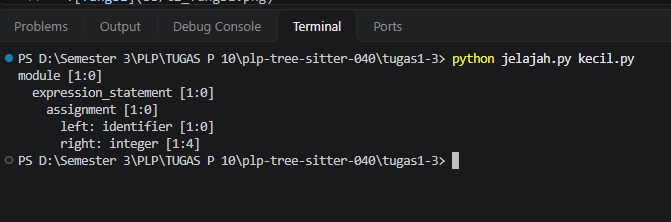
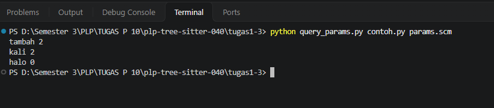
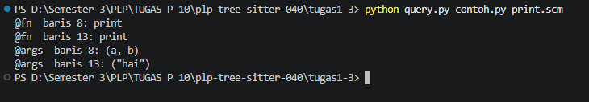
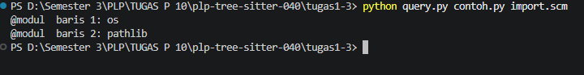
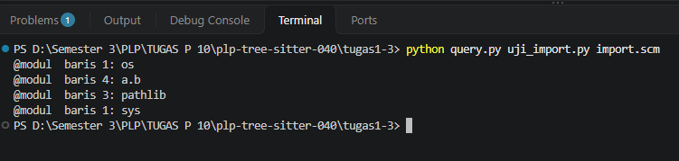

# Laporan Tree-sitter Part 1

## Tugas 1 — Membaca pohon

Saya mem-parse empat potongan kode Python dengan `t1.py` dan mencetak `tree.root_node`: fungsi, if/else, kelas, dan kode rusak.

**Fungsi** (`def sapa(nama): return nama`)


**if/else**


**Kelas**


**Kode rusak** (tanda `:` setelah `def sapa(nama)` dihapus)


**Pohon perkiraan tulisan tangan**


**Penjelasan**

- Node bernama muncul di output `tree.root_node`, misalnya `function_definition`, `identifier`, `parameters`, dan `block`.
- Node anonim tidak tampil di output, tetapi tetap ada di pohon. Contoh dari kode fungsi: `def`, `:`, dan `(` `)` di dalam `parameters`.
- Pada kode rusak, parser tidak lagi mengenali `function_definition`, sehingga semua bagiannya dibungkus node `ERROR`.
- Perbedaan `children` dan `named_children`: pada node `function_definition` dari `def sapa(nama): return nama`, `children` berisi 5 node (`def`, `identifier`, `parameters`, `:`, `block`), sedangkan `named_children` hanya 3 (`identifier`, `parameters`, `block`) karena `def` dan `:` anonim.

**Kendala:** saya belum terbiasa membaca output satu baris panjang. Saya mengatasinya dengan menulis ulang pohon dengan indentasi per tingkat dan membandingkannya dengan output program.

## Tugas 2 — Penjelajah node

`jelajah.py` menelusuri pohon secara rekursif (DFS). Setiap node bernama dicetak dengan indentasi sesuai kedalaman, posisi `baris:kolom`, dan nama field-nya lewat `field_name_for_child(i)`. Node anonim dilewati dengan filter `is_named`.

Pengujian bertahap: `kecil.py` (`x = 1`), `fungsi.py`, lalu file nyata `colorsys.py` (166 baris) dari pustaka standar Python.




**Kendala:**
- Indeks `i` untuk `field_name_for_child(i)` harus berasal dari `node.children` (semua child), bukan `named_children`. Kalau tidak, nama field bergeser atau tidak muncul.
- Output yang dialihkan dengan `>` di PowerShell tersimpan sebagai UTF-16. Saya mengatasinya dengan `| Out-File -Encoding utf8 output_t2.txt`.

## Tugas 3 — Query pertama

Saya menulis query `.scm` dan menjalankannya dengan `QueryCursor` lewat `query.py` (untuk `captures`) dan `query_params.py` (untuk `matches`) pada file uji `contoh.py`.

**Query 1: nama fungsi dan jumlah parameternya** (`params.scm`)

```scheme
(function_definition
  name: (identifier) @nama
  parameters: (parameters) @params)
```



**Query 2: pemanggilan `print(...)`** (`print.scm`)

```scheme
(call
  function: (identifier) @fn
  arguments: (argument_list) @args
  (#eq? @fn "print"))
```



**Query 3: import dan from-import, dicetak nama modulnya** (`import.scm`)

```scheme
(import_statement name: (dotted_name) @modul)
(import_from_statement module_name: (dotted_name) @modul)
```



**Pencocokan dengan hitungan manual pada `contoh.py`**

| Query | Hitungan manual | Hasil program |
| --- | --- | --- |
| Fungsi dan jumlah parameter | `tambah` 2, `kali` 2, `halo` 0 | Sama |
| `print(...)` | 2 (baris 8 dan 13) | Sama |
| Import | `os` (baris 1), `pathlib` (baris 2) | Sama |

**Penjelasan**

- `captures` mengembalikan semua node per nama capture, cocok untuk daftar sederhana. Untuk pasangan nama fungsi dan parameternya saya memakai `matches`, karena dua capture dalam satu pola harus tetap berpasangan.
- Nama node untuk import tidak ditebak: saya menjalankan `jelajah.py` pada `contoh.py` lebih dulu. Hasilnya `import_statement` (field `name:`) dan `import_from_statement` (field `module_name:`), keduanya berisi `dotted_name`.
- `import_from_statement` punya dua `dotted_name`: `module_name:` (modul, misalnya `pathlib`) dan `name:` (yang diimpor, misalnya `Path`). Memakai field `module_name:` memastikan hanya modulnya yang tertangkap.

**Kendala:** untuk jumlah parameter, `captures` tidak bisa memasangkan nama fungsi dengan parameternya, jadi saya beralih ke `matches` dan membaca `cap["params"][0].named_child_count`.## Tugas 3 — Query pertama

Saya menulis query `.scm` dan menjalankannya dengan `QueryCursor` lewat `query.py` (untuk `captures`) dan `query_params.py` (untuk `matches`) pada file uji `contoh.py`.

**Query 1: nama fungsi dan jumlah parameternya** (`params.scm`)

```scheme
(function_definition
  name: (identifier) @nama
  parameters: (parameters) @params)
```


**Query 2: pemanggilan `print(...)`** (`print.scm`)

```scheme
(call
  function: (identifier) @fn
  arguments: (argument_list) @args
  (#eq? @fn "print"))
```


**Query 3: import dan from-import, dicetak nama modulnya** (`import.scm`)

```scheme
(import_statement name: (dotted_name) @modul)
(import_from_statement module_name: (dotted_name) @modul)
```


**Pencocokan dengan hitungan manual pada `contoh.py`**

| Query | Hitungan manual | Hasil program |
| --- | --- | --- |
| Fungsi dan jumlah parameter | `tambah` 2, `kali` 2, `halo` 0 | Sama |
| `print(...)` | 2 (baris 8 dan 13) | Sama |
| Import | `os` (baris 1), `pathlib` (baris 2) | Sama |

**Penjelasan**

- `captures` mengembalikan semua node per nama capture, cocok untuk daftar sederhana. Untuk pasangan nama fungsi dan parameternya saya memakai `matches`, karena dua capture dalam satu pola harus tetap berpasangan.
- Nama node untuk import tidak ditebak: saya menjalankan `jelajah.py` pada `contoh.py` lebih dulu. Hasilnya `import_statement` (field `name:`) dan `import_from_statement` (field `module_name:`), keduanya berisi `dotted_name`.
- `import_from_statement` punya dua `dotted_name`: `module_name:` (modul, misalnya `pathlib`) dan `name:` (yang diimpor, misalnya `Path`). Memakai field `module_name:` memastikan hanya modulnya yang tertangkap.

**Kendala:** untuk jumlah parameter, `captures` tidak bisa memasangkan nama fungsi dengan parameternya, jadi saya beralih ke `matches` dan membaca `cap["params"][0].named_child_count`.

**Pengujian batas query import** (`uji_import.py`)



Query import belum menangkap `import numpy as np` karena bentuk node-nya `aliased_import`. Ini keterbatasan yang saya temukan, tidak diperbaiki karena di luar yang diminta soal.

## Catatan penggunaan AI

| Tugas | Yang diminta | Kesalahan AI | Bukti verifikasi |
| --- | --- | --- | --- |
| 1 | Pohon perkiraan untuk fungsi, if/else, kelas, dan kode rusak | (a) Operator `>` pada `comparison_operator` ditulis tanpa label field. Yang benar `operators: [>]`. (b) Pohon `ERROR` pada kode rusak ditulis tanpa node anonim `def`, `(`, `)`, `return`. | Mencetak pohon lengkap dengan program yang menelusuri `node.children` beserta `field_name_for_child`, lalu membandingkannya dengan tulisan AI. Hasilnya berbeda pada dua bagian itu. |
| 2 | Isi bagian `TODO` pada `jelajah.py` | Tidak ditemukan kesalahan. | Output pada `kecil.py` dan `fungsi.py` sama dengan output yang diberikan di soal. |
| 3 | Query fungsi + parameter, `print`, dan import | Query import tidak menangkap `import numpy as np`, karena node-nya `aliased_import`, bukan `dotted_name` langsung. | Menjalankan `query.py` pada `uji_import.py`: 5 modul diimpor, program hanya menampilkan 4 (`numpy` hilang). |

Catatan: pohon perkiraan tulisan tangan di Tugas 1 dibuat berdasarkan jawaban AI, lalu saya verifikasi dengan menjalankan `t1.py` sendiri.